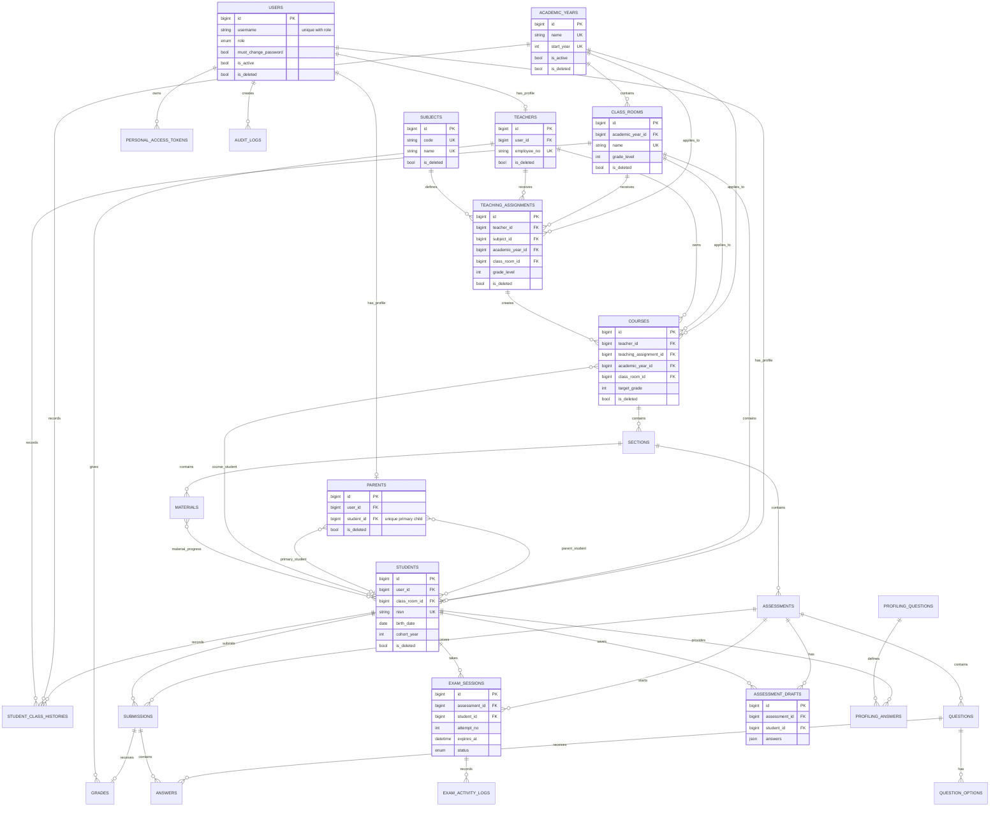

# LMS-SMP data model

This ERD is a documentation view of the current Laravel migrations, including later schema changes for academic years, teaching assignments, soft deletion, assessment drafts, and Sanctum tokens. Migrations remain the schema source of truth.

## Schema notes

- `users.username` is unique together with `users.role`, allowing a student and that student's parent to use the same NISN while remaining separate accounts.
- Application-level soft deletion uses `is_deleted` on users, academic years, classes, teachers, parents, students, courses, subjects, and teaching assignments. These are not Laravel `deleted_at` soft deletes.
- `parents.student_id` is a unique primary-child relation used by the current parent dashboard. The `parent_student` pivot remains in the schema.
- `courses.teaching_assignment_id`, `academic_year_id`, and `class_room_id` are nullable for compatibility with existing courses; new teacher-created courses use a teaching assignment.
- `exam_sessions` use an attempt number and the server-side `expires_at` timestamp. `assessment_drafts` stores answer JSON for the automatic expired-exam submission process.
